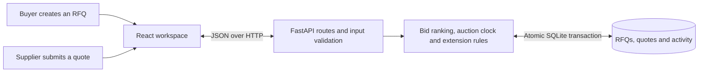
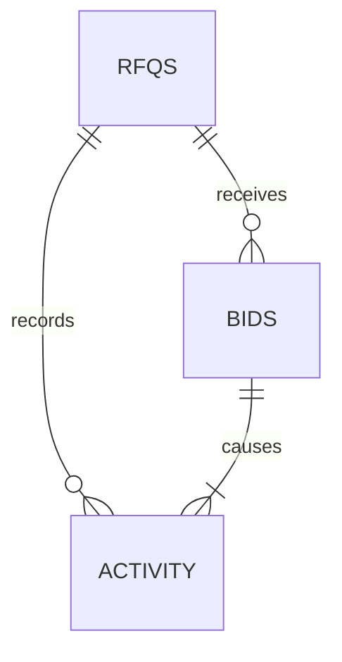

# High-level design

The React workspace polls the API every three seconds and updates the displayed countdown every second. FastAPI serves the built frontend and the JSON API from the same origin. The server clock decides whether to accept a bid. Each bid transaction takes a SQLite write lock before reading the current close or ranking, then commits the quote, any extension, and the activity entries together. Auction status is derived from timestamps on reads and writes, so it stays correct across restarts without a scheduler.

## API

| Method | Route | Purpose |
| --- | --- | --- |
| GET | `/api/rfqs` | List auction summaries |
| POST | `/api/rfqs` | Create a British-auction RFQ |
| GET | `/api/rfqs/{id}` | Read ranked quotes, configuration, and activity |
| POST | `/api/rfqs/{id}/bids` | Submit a quote and return updated auction details |

## Auction semantics

- The configured timestamps must satisfy start < original close < forced close. A bid is accepted from start inclusive until current close exclusive. A current close equal to the hard limit becomes **Force Closed** at that instant. Earlier expiry becomes **Closed**. Future starts are **Scheduled**.
- The trigger window begins X minutes before the current close, inclusive. An accepted bid meeting the selected condition moves close to the lesser of current close plus Y minutes and forced close. The next bid uses this updated close.
- The three trigger modes look for an accepted bid, a change to the ordered supplier list, or a change in L1. A newly ranked supplier changes the ordered list. The first supplier establishes L1, so it counts as an L1 change.
- Total quote is the sum of freight, origin, and destination. The latest accepted quote per carrier is ranked, lowest total first, with earlier submission ID breaking ties. Revisions must improve the carrier's previous total. A new carrier can enter at any positive price. Earlier quotes remain visible as superseded.
- The exercise is a single-currency (USD), local workspace with buyer and supplier actions available in the same UI. Carrier identity is the case-folded, trimmed carrier name.

## Database schema

| Table | Keys | Stored fields |
| --- | --- | --- |
| `rfqs` | `id` PK | Name, route, service date, start, original close, current close, forced close, trigger window, extension duration, trigger rule |
| `bids` | `id` PK, `rfq_id` FK | Carrier name, normalized supplier key, freight/origin/destination charges, computed total, transit days, validity date, submission time |
| `activity` | `id` PK, `rfq_id` and `bid_id` FKs | Event kind and time, extension reason, previous close, new close |

Amounts are integer cents and timestamps are UTC epoch milliseconds. Calendar dates use ISO YYYY-MM-DD. SQLite prevents invalid deadline ordering and enforces foreign keys on every application connection. Indexes support quote price ordering and activity retrieval by RFQ. See [schema.sql](../backend/schema.sql) for the executable DDL.
